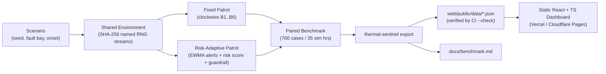

# Thermal Sentinel

[](https://github.com/aryanhood/thermal-sentinel/actions/workflows/ci.yml)


**Does letting an inspection robot interrupt its fixed patrol route on noisy line telemetry confirm thermal faults faster — without unacceptable false-alarm detours or coverage gaps?**

Thermal Sentinel answers that question with a **paired, deterministic simulation engine** (zero runtime Python dependencies), a **700-scenario benchmark** (35 simulated hours per policy), and a **zero-backend React + TypeScript replay dashboard** ready for Vercel or Cloudflare Pages.

---

## Benchmark Results (700 Paired Scenarios)

Both policies run against the **exact same pre-sampled `Environment`** (identical baselines, thermocouple noise, transient glitches, and camera noise) across 100 seeds × 7 fault configurations (6 fault bays + 1 fault-free control). Full reproducible report: [`docs/benchmark.md`](docs/benchmark.md).

| Metric | Fixed patrol | Risk-adaptive |
|---|---:|---:|
| Detection rate (600 faulted cases) | 100.0% | 100.0% |
| Time to confirm — median | 33.0 s | **18.5 s** |
| Time to confirm — p90 | 50.5 s | **22.5 s** |
| Mean time saved (paired) | — | **14.3 s** *(95% CI: 13.35 – 15.27 s)* |
| Distance per mission — mean | 79.4 m | 82.87 m *(+4.39%)* |
| False alarms / hour | 0.0 | 6.57 *(0 false confirmations)* |
| Worst coverage gap (90 s guardrail) | 49.5 s | 75.5 s *(100% compliant)* |

**Outcomes on 600 faulted cases:** adaptive faster **502** (83.7%), tie **77**, fixed faster **21**.

> **Honest trade-off:** Trusting noisy line sensors means transient glitches trigger false-alarm detours (`6.57/hr`), `+4.39%` extra travel distance, and a larger worst-case coverage gap (`75.5 s` vs `49.5 s`). A hard coverage guardrail keeps every run within the `90 s` SLA, and low-noise close inspections keep false confirmations at **0**.

---

## Architecture



- **Why static export + client-side replay?** Every visitor gets an independent timeline scrubber, floor-map animation, and decision inspector with zero shared server state and zero cold starts ([ADR-003](docs/adr/0003-static-export-and-client-replay.md)).
- **Why explainable scoring instead of ML?** Every retarget logs its exact linear score (`0.7·thermal + 0.2·staleness − 0.1·travel`), making behavior auditable and tunable without an external dataset ([ADR-002](docs/adr/0002-explainable-scoring.md)).

---

## Quick Start

### Python CLI & Benchmark

```bash
uv sync

# Run a single paired scenario (any seed)
uv run thermal-sentinel run --seed 3 --fault B5

# Run the full 700-case benchmark
uv run thermal-sentinel benchmark

# Regenerate static web data + docs/benchmark.md (checked in CI)
uv run thermal-sentinel export
```

### Interactive Web Dashboard

```bash
cd web
npm ci
npm run dev
```

Open `http://localhost:5173` to explore the **Side-by-Side Replay Simulator** (42 pre-exported scenarios across Seeds 1–6) and the **700-Case Benchmark Explorer**.

---

## Verification & Quality Gates

```bash
# Full Python + Web check suite
make check
```

| Layer | Tooling | Gate |
|---|---|---|
| Python lint & format | `ruff` | Zero warnings |
| Python typing | `mypy --strict` | Zero errors (`py.typed`) |
| Python tests | `pytest` + `hypothesis` | 43 unit + property tests, ≥ 90% branch coverage (currently ~97%) |
| Data freshness | `thermal-sentinel export --check` | Fails CI if JSON or `docs/benchmark.md` drifts from code |
| Web quality | `tsc --noEmit`, `biome`, `vitest`, `vite build` | Zero errors, production bundle verified |

---

## Deploying to Vercel or Cloudflare Pages

The `web/` directory is a self-contained static site with pre-exported data in `web/public/data/` and security/caching headers in `web/vercel.json` and `web/public/_headers`:

- **Root Directory:** `web`
- **Build Command:** `npm run build`
- **Output Directory:** `dist`

---

## Documentation

- [System Architecture & Simulation-to-Reality Gaps](docs/architecture.md)
- [Benchmark Report (generated)](docs/benchmark.md)
- [ADR-001: Paired Evaluation on a Shared Environment](docs/adr/0001-paired-shared-environment.md)
- [ADR-002: Explainable Risk Scoring](docs/adr/0002-explainable-scoring.md)
- [ADR-003: Deterministic Static Export & Client-Side Replay](docs/adr/0003-static-export-and-client-replay.md)
- [Contributing](CONTRIBUTING.md) · [Security](SECURITY.md) · [Changelog](CHANGELOG.md)

MIT License
