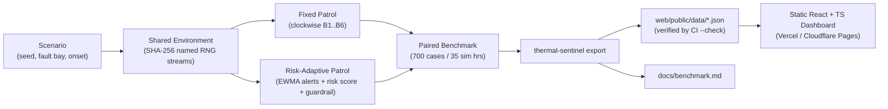

# Thermal Sentinel

[](https://github.com/aryanhood/thermal-sentinel/actions/workflows/ci.yml)


## Research Question

In an automated battery lab, a mobile robot patrols six test bays while fixed thermocouples stream noisy line temperatures. When a line sensor spikes, should the robot stay on its fixed schedule or break route to inspect the bay up close?

Thermal Sentinel is a paired discrete-event simulation built to test both policies under identical conditions. Each scenario pre-samples the thermal environment so that both the fixed patrol and the risk-adaptive patrol see the same baseline temperatures, sensor noise, transient glitches, and fault onset times.

---

## Benchmark Results (700 Paired Scenarios)

We evaluate both policies across 100 random seeds and 7 fault configurations (a thermal ramp in Bay 1 through Bay 6, plus one fault-free control run), totaling 700 paired scenarios or 35 simulated hours per policy. Full report: [`docs/benchmark.md`](docs/benchmark.md).

| Metric | Fixed patrol | Risk-adaptive |
|---|---:|---:|
| Detection rate (600 faulted cases) | 100.0% | 100.0% |
| Time to confirm, median | 33.0 s | **18.5 s** |
| Time to confirm, p90 | 50.5 s | **22.5 s** |
| Mean time saved (paired) | — | **14.3 s** *(95% CI: 13.35 – 15.27 s)* |
| Distance per mission, mean | 79.4 m | 82.87 m *(+4.39%)* |
| False alarms per hour | 0.0 | 6.57 *(0 false confirmations)* |
| Worst coverage gap (90 s guardrail) | 49.5 s | 75.5 s *(100% compliant)* |

**Outcomes across 600 faulted cases:** adaptive is faster in **502** runs (83.7%), ties in **77**, and is slower in **21**.

> **Trade-off:** Because the adaptive policy reacts to line telemetry, transient thermocouple glitches cause `6.57` false-alarm detours per hour, `+4.39%` extra travel distance, and a wider worst-case coverage gap (`75.5 s` vs `49.5 s`). A hard staleness guardrail keeps every bay within the `90 s` inspection window, and the close-range camera check prevents any false confirmations (`0`).

---

## Architecture



- **Linear risk scoring:** When an EWMA line alert triggers, the adaptive planner ranks candidate bays using `0.7·thermal + 0.2·staleness − 0.1·travel` and records the term breakdown for every retarget ([ADR-002](docs/adr/0002-explainable-scoring.md)).
- **Static export and client-side replay:** The Python engine exports compact timelines and benchmark summaries to JSON. The browser replays runs locally, so visitors never share server state ([ADR-003](docs/adr/0003-static-export-and-client-replay.md)).

---

## Quick Start

### Python CLI & Benchmark

```bash
uv sync

# Run a single paired scenario (any seed)
uv run thermal-sentinel run --seed 3 --fault B5

# Run the full 700-case benchmark
uv run thermal-sentinel benchmark

# Regenerate static web data + docs/benchmark.md (checked in CI)
uv run thermal-sentinel export
```

### Interactive Web Dashboard

```bash
cd web
npm install
npm run dev
```

Open `http://localhost:5173` to step through the side-by-side floor map replay (42 exported scenarios across seeds 1–6) and inspect the 700-case benchmark distributions.

---

## Verification & Quality Gates

```bash
# Full Python + Web check suite
make check
```

| Layer | Tooling | Gate |
|---|---|---|
| Python lint & format | `ruff` | Zero warnings |
| Python typing | `mypy --strict` | Zero errors (`py.typed`) |
| Python tests | `pytest` + `hypothesis` | 43 unit + property tests, ≥ 90% branch coverage (currently ~97%) |
| Data freshness | `thermal-sentinel export --check` | Fails CI if JSON or `docs/benchmark.md` drifts from code |
| Web quality | `tsc --noEmit`, `biome`, `vitest`, `vite build` | Zero errors, production bundle verified |

---

## Deploying to Vercel or Cloudflare Pages

The `web/` directory is a static frontend backed by the exported JSON in `web/public/data/`:

- **Root Directory:** `web`
- **Build Command:** `npm run build`
- **Output Directory:** `dist`

---

## Documentation

- [System Architecture & Simulation-to-Reality Gaps](docs/architecture.md)
- [Benchmark Report (generated)](docs/benchmark.md)
- [ADR-001: Paired Evaluation on a Shared Environment](docs/adr/0001-paired-shared-environment.md)
- [ADR-002: Explainable Risk Scoring](docs/adr/0002-explainable-scoring.md)
- [ADR-003: Deterministic Static Export & Client-Side Replay](docs/adr/0003-static-export-and-client-replay.md)
- [Contributing](CONTRIBUTING.md) · [Security](SECURITY.md) · [Changelog](CHANGELOG.md)

MIT License
