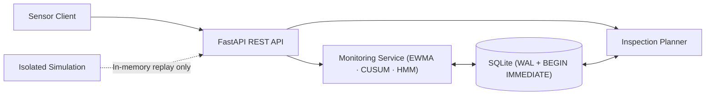

# Thermal Sentinel

An industrial thermal monitoring prototype built with **FastAPI**, **SQLite**, and a paired robot inspection simulation.

It receives temperature readings over a REST API, binds one sensor per equipment bay, detects abnormal heating trends while filtering brief sensor glitches, and recommends which bay an inspection robot should check next.

> **Note:** This is a software monitoring prototype, not a production factory system. The backend API, SQLite database, anomaly detectors, and inspection planner are working software, while the test scenarios come from a deterministic simulation rather than physical sensors or real robot hardware.

---

## What It Does

- **One-Sensor-Per-Bay Ingestion (`FastAPI`):** Accepts single or batch temperature readings bound to each bay's configured sensor (`thermocouple-B1`..`thermocouple-B6` by default). Exact retries return HTTP `200` (`duplicate: true`) without double-updating detectors, conflicting values at an existing timestamp return `409`, future timestamps beyond 5 s skew return `422`, and older out-of-order readings are archived (`out_of_order: true`) without changing live detector state.
- **SQLite Storage:** Saves equipment, readings, alerts, and inspection logs using WAL mode and serialized `BEGIN IMMEDIATE` transactions so concurrent requests and batches stay consistent.
- **Trend Monitoring & Alert Lifecycle:** Tracks heating above each bay's baseline using EWMA, Page's CUSUM, and a 3-state Bayesian HMM. Alerts move cleanly through `open` → `acknowledged` → `confirmed` / `resolved`. Updating a bay's baseline resolves any active alerts on that bay in the same transaction.
- **Inspection Planner:** Ranks which bay needs attention next using fault risk, time since last visit, and travel distance, and rejects stale verification timestamps older than prior checks or active alerts (`409`).
- **Isolated Simulation Testbed:** Benchmarks five policies on identical noise streams (`thermal-sentinel benchmark`) and runs API replays (`POST /api/v1/simulation/replay`) inside an isolated in-memory database without altering operational data.



---

## Main API Endpoints

| Endpoint | Description |
|---|---|
| `GET /health` | Health check (`200` when healthy, `503` if SQLite check fails), active policy, and open alert count |
| `GET / POST /api/v1/equipment` | List or register equipment bays with unique bound `sensor_id` |
| `PATCH /api/v1/equipment/{bay_id}/baseline` | Update baseline temperature and resolve active alerts on that bay |
| `POST / GET /api/v1/readings` | Ingest or query timestamped readings (`/batch` rolls back atomically on any failure) |
| `GET / POST /api/v1/alerts` | List alerts or acknowledge an open alert via `/{alert_id}/acknowledge` |
| `GET /api/v1/inspection/next` | Get the next recommended bay for robot inspection |
| `POST /api/v1/inspection/verify` | Record a close-range camera check (`confirmed`, `watch`, `false_alarm`, `nominal`) |
| `POST /api/v1/simulation/replay` | Run an isolated simulation replay without modifying stored operational data |

Full interactive OpenAPI docs are available at `http://127.0.0.1:8000/docs` when running locally.

---

## Quick Start

### Run Locally

```bash
uv sync
uv run thermal-sentinel serve --host 127.0.0.1 --port 8000
```

Try ingesting a reading and querying the planner in another terminal:

```bash
curl -X POST http://127.0.0.1:8000/api/v1/readings \
  -H "Content-Type: application/json" \
  -d '{"bay_id": "B5", "sensor_id": "thermocouple-B5", "temperature_c": 34.5}'

curl http://127.0.0.1:8000/api/v1/inspection/next
```

### Run with Docker

```bash
docker compose up --build
```

### Run Tests and Simulation

```bash
uv run pytest --cov
uv run ruff check . && uv run mypy
uv run thermal-sentinel benchmark
cd web && npm install && npm run check
```

---

## Simulation Benchmark

Five policies evaluated across **700 paired scenarios** (`35.0` simulated hours per policy) on identical sensor noise and glitches. Full breakdown: [docs/benchmark.md](docs/benchmark.md).

| Policy | Detect % | Median Confirm Time | Saved vs. Fixed | False Alarms / hr | Guardrail % |
|---|---:|---:|---:|---:|---:|
| Fixed Patrol | 100.0% | 33.0 s | 0.0 s | 0.0 | 100.0% |
| Greedy EWMA | 100.0% | 18.5 s | 14.28 s | 6.69 | 100.0% |
| Risk-Adaptive EWMA | 100.0% | 18.5 s | 14.3 s | 6.57 | 100.0% |
| Page CUSUM | 100.0% | 22.5 s | 11.15 s | 0.57 | 100.0% |
| **3-State Bayesian HMM** | **100.0%** | **16.0 s** | **17.01 s** | **0.09** | **100.0%** |


---

## Limitations

- **Prototype only:** No direct integration with physical PLCs, MQTT brokers, or real robot hardware.
- **Single-sensor binding:** Each equipment bay accepts readings from one bound sensor ID.
- **Simplified physics:** The simulation uses linear heating ramps and constant-speed straight-line robot travel without obstacles.
- **Detector prior:** The Bayesian HMM assumes transient spikes are around `+3.0 °C`; Page's CUSUM (`THERMAL_SENTINEL_POLICY=cusum`) is available as a simpler alternative when spike size is unknown.

---

## Docs

[Architecture](docs/architecture.md) · [Benchmark Report](docs/benchmark.md) · [ADRs](docs/adr/0001-paired-shared-environment.md) · MIT License
