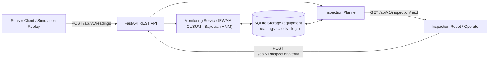

# Thermal Sentinel

An **industrial thermal monitoring prototype** built with **FastAPI**, **SQLite**, sequential change-point detection, and a paired robot inspection simulation.

This system receives timestamped temperature readings over a REST API, stores equipment state and readings in SQLite, detects abnormal heating trends while filtering brief sensor glitches, and recommends which equipment bay an inspection robot should check next.

> **Important scope note:** This repository is an **industrial monitoring prototype**, not a production-deployed factory system. The backend API, database, anomaly detectors, and decision logic are real working software, while the robot movement and thermocouple scenarios come from a deterministic simulation environment for testing and benchmarking.

---

## 1. What This Prototype Does

- **Sensor Data Ingestion (`FastAPI`):** Accepts single or batch temperature readings via validated REST endpoints (`POST /api/v1/readings` and `POST /api/v1/readings/batch`).
- **Persistent Storage (`SQLite`):** Stores equipment bay configurations, timestamped sensor readings, alert histories, and inspection verification logs in a thread-safe SQLite database.
- **Thermal Trend Monitoring:** Tracks every reading through three sequential filters—EWMA, Page's CUSUM, and a 3-state Bayesian Hidden Markov Model (`NOMINAL`, `GLITCH`, `FAULT_RAMP`)—and raises or resolves alerts automatically.
- **Inspection Prioritization:** Ranks which equipment bay needs attention next (`GET /api/v1/inspection/next`) based on active fault risk, time since last check, and robot travel distance, and records close-range verification outcomes (`POST /api/v1/inspection/verify`).
- **Simulation Test Environment:** Includes a deterministic 6-bay simulation (`thermal-sentinel benchmark` and `POST /api/v1/simulation/replay`) to evaluate detection speed and false alarms fairly across identical sensor streams.

---

## 2. System Architecture



For module details and state transitions, see [docs/architecture.md](docs/architecture.md).

---

## 3. REST API Overview

| Method & Path | Purpose |
|---|---|
| `GET /health` | Service status, SQLite connectivity, active policy, and open alert count |
| `GET /api/v1/equipment` | List all equipment bays and their latest thermal and detector states |
| `POST /api/v1/equipment` | Register a new equipment bay and its baseline temperature |
| `PATCH /api/v1/equipment/{bay_id}/baseline` | Update commissioned baseline temperature for a bay |
| `POST /api/v1/readings` | Ingest one timestamped temperature reading and update alerts |
| `POST /api/v1/readings/batch` | Validate and ingest a batch of readings in order |
| `GET /api/v1/readings` | Query stored readings (filter by `bay_id`, `since`, `limit`) |
| `GET /api/v1/alerts` | List alerts (filter by `status` or `bay_id`) |
| `POST /api/v1/alerts/{alert_id}/acknowledge` | Acknowledge an open alert |
| `GET /api/v1/inspection/next` | Recommend the next equipment bay for inspection |
| `POST /api/v1/inspection/verify` | Record a close-range camera check (`confirmed`, `watch`, `false_alarm`, `nominal`) |
| `GET /api/v1/inspection/logs` | View robot dispatch and verification logs |
| `POST /api/v1/simulation/replay` | Stream a simulated scenario into the live monitoring pipeline |

### Example API Workflow

```bash
# 1. Start the server
thermal-sentinel serve --host 127.0.0.1 --port 8000

# 2. Replay a simulated fault scenario (seed 3, fault on Bay B5) through the API
curl -X POST http://127.0.0.1:8000/api/v1/simulation/replay \
  -H "Content-Type: application/json" \
  -d '{"seed": 3, "fault_bay_id": "B5", "max_ticks": 140}'

# 3. Ask the planner which bay needs inspection next
curl "http://127.0.0.1:8000/api/v1/inspection/next"

# 4. Submit a close-range thermal camera check to confirm the fault
curl -X POST http://127.0.0.1:8000/api/v1/inspection/verify \
  -H "Content-Type: application/json" \
  -d '{"bay_id": "B5", "camera_temp_c": 32.0}'
```

---

## 4. Simulation Benchmark Results

To test how different anomaly detectors behave before using them in the API, the simulation environment evaluates five policies across **700 paired scenarios** (`100` seeds × `7` configurations: faults on `B1..B6` plus fault-free controls, `35.0` simulated hours per policy). Every policy sees the exact same noise and glitch realizations. Full report: [docs/benchmark.md](docs/benchmark.md).

| Policy | Detect % | TTC Median | TTC p90 | Mean Saved vs Fixed | Mean Dist | False Alarms/hr | Worst Gap | Guardrail % |
|---|---:|---:|---:|---:|---:|---:|---:|---:|
| Fixed Patrol | 100.0% | 33.0 s | 50.5 s | 0.0 s | 79.4 m | 0.0 | 49.5 s | 100.0% |
| Greedy EWMA | 100.0% | 18.5 s | 22.5 s | 14.28 s | 82.84 m | 6.69 | 75.5 s | 100.0% |
| Risk-Adaptive EWMA | 100.0% | 18.5 s | 22.5 s | 14.3 s | 82.87 m | 6.57 | 75.5 s | 100.0% |
| Page CUSUM | 100.0% | 22.5 s | 26.0 s | 11.15 s | 82.14 m | 0.57 | 74.0 s | 100.0% |
| **3-State Bayesian HMM** | **100.0%** | **16.0 s** | **19.5 s** | **17.01 s** | 82.52 m | **0.09** | **66.5 s** | **100.0%** |


---

## 5. Quick Start

### Run the FastAPI Monitoring Server Locally

```bash
uv sync
uv run thermal-sentinel serve --host 127.0.0.1 --port 8000
```

Interactive OpenAPI docs are available at `http://127.0.0.1:8000/docs`.

### Run with Docker Compose

```bash
docker compose up --build
```

The API listens on port `8000` and persists SQLite data in the `thermal_sentinel_data` volume.

### Run the Simulation CLI & Web Replay Dashboard

```bash
# Run one paired simulation scenario
uv run thermal-sentinel run --seed 3 --fault B5

# Run the 700-case simulation benchmark
uv run thermal-sentinel benchmark

# Verify exported dashboard JSON and docs/benchmark.md match simulation code
uv run thermal-sentinel export --check

# Start the static React replay dashboard
cd web && npm install && npm run dev
```

### Quality Gates

```bash
uv run ruff check .
uv run ruff format --check .
uv run mypy
uv run pytest --cov
cd web && npm run check
```

---

## 6. Scope and Limitations

- **Prototype Hardware Boundary:** Readings are ingested over HTTP rather than directly from physical plant PLCs, MQTT brokers, or physical mobile robots.
- **Prior Assumptions in Bayesian Filtering:** The 3-state Bayesian HMM assumes transient glitches resemble a `+3.0 °C` spike distribution. Under sustained offset drift or unmodeled spike magnitudes, Page's CUSUM provides a simpler non-parametric fallback (`THERMAL_SENTINEL_POLICY=cusum`).
- **Simulation Simplifications:** The test simulation models equipment heating as linear ramps capped at `+15 °C` and robot travel as constant `1.0 m/s` straight-line motion without physical obstacles.

---

## Documentation

- [System Architecture](docs/architecture.md)
- [Generated Benchmark Report](docs/benchmark.md)
- [ADR-001: Paired Evaluation on a Shared Environment](docs/adr/0001-paired-shared-environment.md)
- [ADR-002: Explainable Risk Scoring](docs/adr/0002-explainable-scoring.md)
- [ADR-003: Deterministic Static Export & Client-Side Replay](docs/adr/0003-static-export-and-client-replay.md)

MIT License
