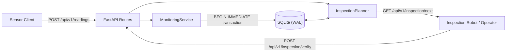
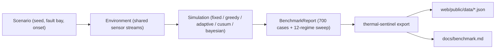

# System Architecture

Thermal Sentinel is an **industrial thermal monitoring prototype** combining two isolated layers:

1. **Monitoring Backend (`FastAPI` + `SQLite`):** Ingests timestamped readings for bound sensors, tracks thermal trends, manages alert lifecycles, and recommends inspection priorities.
2. **Simulation Testbed:** Evaluates five patrol and detection policies under identical pre-sampled sensor streams (`700` paired cases / `35.0` simulated hours) and supports isolated in-memory API replays.

## Live Monitoring Data Flow

## Simulation & Benchmark Data Flow

## Components

| Module | Responsibility |
|---|---|
| `thermal_sentinel.storage` | Thread- and multi-connection-safe SQLite store (`equipment`, `sensor_readings`, `alerts`, `inspection_logs`) using `BEGIN IMMEDIATE` transactions, CHECK/UNIQUE constraints, WAL mode, and UTC timestamps. |
| `thermal_sentinel.monitoring` | Enforces one-sensor-per-bay binding, future clock-skew rejection, exact-retry deduplication, out-of-order archiving, EWMA/CUSUM/Bayesian HMM updates, and alert lifecycle transitions. |
| `thermal_sentinel.inspection` | Computes next inspection targets (alert score, wall-clock staleness guardrail, patrol route), blocks stale inspection timestamps, and isolates simulation replay in temporary in-memory SQLite. |
| `thermal_sentinel.api` | Modular FastAPI application (`routes/health.py`, `routes/equipment.py`, `routes/readings.py`, `routes/alerts.py`, `routes/inspection.py`) with Pydantic v2 validation and strict HTTP error mapping. |
| `thermal_sentinel.model` | Immutable `Bay` and `Scenario` dataclasses, validation, and SHA-256 named RNG streams (`seeded_rng`). |
| `thermal_sentinel.environment` | Pre-computes ground-truth temperature ramps, noisy fixed thermocouple time series, and on-demand camera noise. |
| `thermal_sentinel.simulation` | Time-stepped (`dt = 0.5 s`, horizon `180 s`) benchmark simulator and validated `PolicyConfig`. |
| `thermal_sentinel.benchmark` | Runs 100 seeds × 7 fault configurations = 700 paired cases and a 12-regime sensitivity sweep. |
| `thermal_sentinel.export` | Emits byte-stable JSON timelines and `docs/benchmark.md`, plus `--check` for CI drift detection. |
| `web/` | Static React + TypeScript + Vite dashboard that replays exported simulation timelines client-side. |

## Data Integrity Rules

- **One-sensor-per-bay binding:** Each bay binds to one unique `sensor_id` (`thermocouple-B1`..`thermocouple-B6` by default); readings carrying a mismatched `sensor_id` fail with `409 Conflict`.
- **Timestamp & retry semantics:** Exact retries of `(bay_id, recorded_at, temperature_c)` return HTTP `200` (`duplicate: true`) without re-running detectors; `POST /api/v1/readings/batch` returns `total_count`, `created_count`, and `duplicate_count`, responding with `201` if any new reading is stored and `200` when every item is a duplicate retry. Conflicting temperatures at the same timestamp return `409 Conflict`. Readings older than `last_reading_at` are archived with `out_of_order: true` without mutating equipment or alert state. Both explicit and server-assigned timestamps (`recorded_at` omitted) respect the 5 s future clock-skew limit and fail with `422` if exceeded.
- **Alert & verification lifecycle:** Only one active (`open` or `acknowledged`) alert per bay is permitted at the database level. Updating a bay baseline atomically resolves active alerts; acknowledging an already `confirmed` or `resolved` alert fails with `409`; verification timestamps older than `last_inspected_at` or the active alert fail with `409`.
- **Prototype boundary:** No physical hardware drivers, PLC interfaces, or safety-certified robot controllers are connected.
