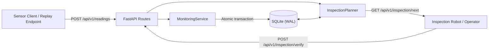
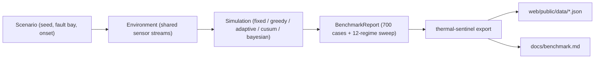

# System Architecture

Thermal Sentinel is an **industrial thermal monitoring prototype** combining two tightly connected parts:

1. **Monitoring Backend (`FastAPI` + `SQLite`):** Ingests timestamped temperature measurements via REST, tracks equipment thermal trends, manages alert lifecycles, and recommends inspection priorities.
2. **Paired Simulation Environment:** Evaluates five patrol and detection policies under identical pre-sampled sensor streams (`700` paired cases / `35.0` simulated hours) and streams deterministic test cases into the monitoring API.

## Live Monitoring Data Flow

## Simulation & Benchmark Data Flow

## Components

| Module | Responsibility |
|---|---|
| `thermal_sentinel.storage` | Thread-safe SQLite repository (`equipment`, `sensor_readings`, `alerts`, `inspection_logs`) using explicit `BEGIN IMMEDIATE` transactions, UTC timestamps, and WAL mode. |
| `thermal_sentinel.monitoring` | Atomically checks timestamp ordering (archiving late readings with `out_of_order=True`), updates EWMA, Page CUSUM, and 3-state Bayesian HMM detectors, and opens/resolves alerts cleanly. |
| `thermal_sentinel.inspection` | Computes next inspection targets (alert score, staleness guardrail, patrol route), verifies close-range checks atomically, and replays simulation scenarios into the API non-destructively by default (`reset_first=False`). |
| `thermal_sentinel.api` | Modular FastAPI application (`routes/health.py`, `routes/equipment.py`, `routes/readings.py`, `routes/alerts.py`, `routes/inspection.py`) with Pydantic v2 validation. |
| `thermal_sentinel.model` | Immutable `Bay` and `Scenario` dataclasses, validation, and SHA-256 named RNG streams (`seeded_rng`). |
| `thermal_sentinel.environment` | Pre-computes ground-truth temperature ramps, noisy fixed thermocouple time series, and on-demand camera noise. |
| `thermal_sentinel.simulation` | Time-stepped (`dt = 0.5 s`, horizon `180 s`) benchmark simulator shared across all five policies. |
| `thermal_sentinel.benchmark` | Runs 100 seeds × 7 fault configurations = 700 paired cases and a 12-regime sensitivity sweep. |
| `thermal_sentinel.export` | Emits byte-stable JSON timelines and `docs/benchmark.md`, plus `--check` for CI drift detection. |
| `web/` | Static React + TypeScript + Vite dashboard that replays exported simulation timelines client-side. |

## Prototype Boundaries and Limitations

- **No physical hardware drivers:** Sensor inputs arrive over REST HTTP requests rather than fieldbus/PLC interfaces or real mobile robot controllers.
- **Thermal physics (simulation):** Faults in simulation runs are modeled as linear ramps capped at `+15 °C`, not coupled heat-transfer PDEs.
- **Kinematics (simulation):** Constant `1.0 m/s` straight-line motion in free space without obstacle avoidance.
- **Safety boundary:** This repository is a software monitoring prototype and policy benchmark, not safety-certified industrial control software.
