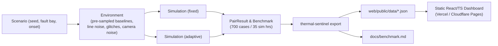

# System Architecture

Thermal Sentinel evaluates a single operational question: **does letting an inspection robot interrupt its fixed patrol route in response to noisy line telemetry confirm real thermal faults faster, without unacceptable false-alarm overhead or coverage gaps?**

## High-level Data Flow

## Components

| Module | Responsibility |
|---|---|
| `thermal_sentinel.model` | Immutable `Bay` and `Scenario` dataclasses, validation, and SHA-256 named RNG streams (`seeded_rng`). |
| `thermal_sentinel.environment` | Pre-computes ground-truth temperature ramps, noisy fixed thermocouple time series (including transient glitches), and on-demand camera noise. |
| `thermal_sentinel.simulation` | Time-stepped (`dt = 0.5 s`, horizon `180 s`) state machine (`IDLE`, `MOVING`, `SCANNING`, `CONFIRMING`) shared by both policies. |
| `thermal_sentinel.benchmark` | Runs 100 seeds × 7 fault configurations (6 bays + 1 fault-free control) = 700 paired cases and computes summary distributions + 95% percentile bootstrap CIs. |
| `thermal_sentinel.export` | Emits byte-stable JSON timelines and `docs/benchmark.md`, plus `--check` for CI drift detection. |
| `web/` | Zero-backend React + TypeScript + Vite dashboard that replays timelines client-side and renders benchmark analytics. |

## Policy State Machine

Both policies share the exact same physical kinematics, scan/close-inspection durations, camera confirmation thresholds, and route order (`B1 → B2 → B3 → B4 → B5 → B6 → B1`).

1. **Line sensing (every tick):** Each bay's thermocouple delta is smoothed with an EWMA (`alpha = 0.3`). Crossing `+1.2 °C` raises a `line_alert`; dropping below `+0.6 °C` clears it (hysteresis).
2. **Fixed policy:** Ignores line alerts and follows the clockwise route. If a routine scan reads `≥ +1.0 °C`, it immediately performs a lower-noise close inspection (`6 s`) to confirm (`≥ +1.5 °C`).
3. **Adaptive policy:** Monitors active line alerts. When an alert appears, it scores all alerted bays:
   `score = 0.7 · thermal + 0.2 · staleness - 0.1 · travel`
   and interrupts transit if a higher-priority bay needs immediate close inspection. If a bay is unvisited for `≥ 80%` of `max_unseen_s` (`72 s`) and no alerts are active, a coverage guardrail forces a visit.
4. **Dwell & re-arm:** If a close inspection lands between `watch_c` (`1.0 °C`) and `confirm_c` (`1.5 °C`), the robot dwells up to 2 extra cycles to re-measure before declaring a false alarm. After a false alarm, that bay's alert is suppressed for `15 s` (`rearm_after_s`) or until telemetry drops below `alert_off_c`.

## Simulation-to-Reality Gaps

- **Thermal physics:** Faults are modeled as linear ramps capped at `+15 °C`, not coupled electrochemical or heat-transfer PDEs.
- **Kinematics & localization:** Constant `1.0 m/s` straight-line motion in free space with zero acceleration, obstacle avoidance, or localization drift.
- **Sensor model:** Additive Gaussian noise plus Bernoulli transient spikes; real IR cameras have emissivity, angle-of-incidence, and calibration effects.
- **Safety boundary:** This repository is a decision-policy benchmark, not safety-certified control software.
